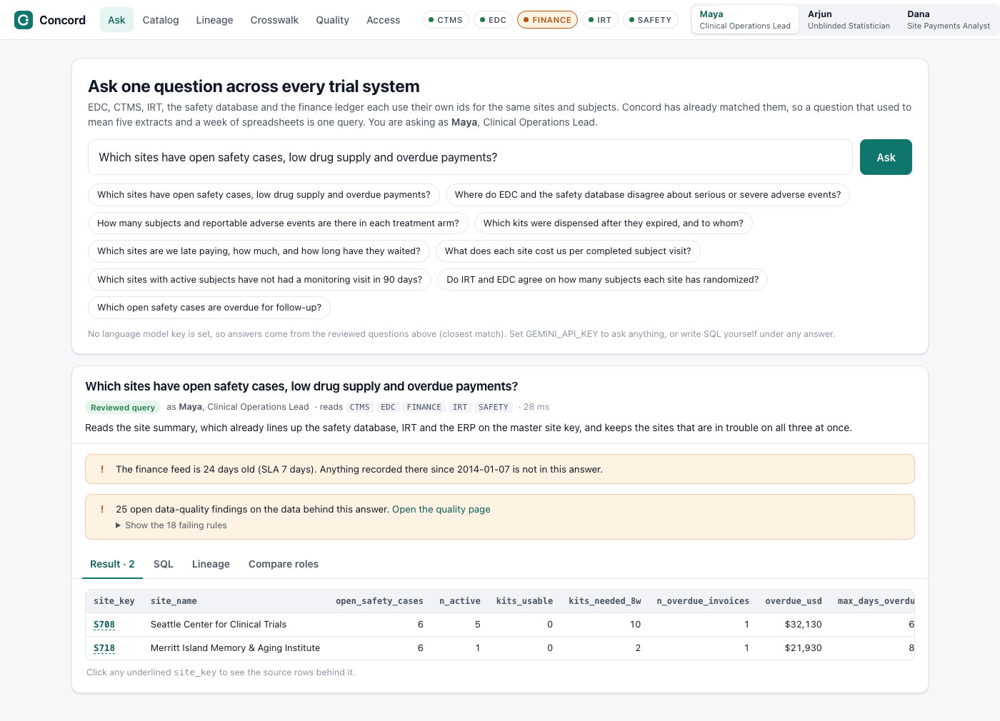

# Concord

**One question across every clinical trial system.**

A trial's data lives in a dozen systems that do not talk to each other. The same site is `SITE-0701` in
the trial management system, `701` in the trial database, `US701` in drug supply, a free-text name in the
safety database and a vendor's legal name in finance. So a simple question like

> Which sites have open safety cases **and** low drug supply **and** overdue payments?

turns into five extract requests and a week of spreadsheet matching, and nobody fully trusts the answer.

Concord ingests the five feeds, works out which ids mean the same site and the same subject, and lets a
study team ask that question in plain English. Every answer shows the SQL that ran, the source rows behind
each number, how fresh each source is, what data-quality problems touch it, and what the person asking was
not allowed to see.

Built for the Regeneron challenge at HackRU Fall 2026, starter sheet 40, *One Source of Truth*.



## Run it

Needs Python 3.10 or newer. Nothing else: no database server, no Docker, no API key.

```bash
git clone https://github.com/shon6360/HackRU-2026-Project.git && cd HackRU-2026-Project
python3 -m venv .venv && source .venv/bin/activate
pip install -r requirements.txt
python -m concord serve
```

Open http://127.0.0.1:8040. The first start builds the warehouse from the committed feeds in about two seconds.

```bash
python -m concord build          # rebuild the warehouse, catalog, quality results and role databases
python tests/test_concord.py     # 10 end-to-end checks (also runs under pytest)
python -m concord ask "Which sites are we late paying?" --role finance
```

To ask free-form questions, give Concord a Gemini API key. Create one at
[Google AI Studio](https://aistudio.google.com/apikey), then:

```bash
cp .env.example .env             # then open .env and paste the key after GEMINI_API_KEY=
python -m concord serve          # restart the server whenever .env changes
```

`.env` is gitignored, so the key stays on your machine. A `GEMINI_API_KEY` exported in the shell works too
and takes precedence over the file. Without a key, Concord answers from nine reviewed questions (closest
match) and you can write SQL yourself under any answer.

## What to try

1. **Ask.** Click *Which sites have open safety cases, low drug supply and overdue payments?* Two sites come
   back. The answer warns that the finance feed is 24 days stale, so payments made since then are not in it.
2. **Trace.** Click `S718` in the result. The drawer shows how each of the five systems' ids was matched to
   that site, with the evidence, and the raw rows from each source file. The finance match is flagged for a
   data steward, because two sites in the same city have nearly the same name.
3. **Switch role.** Ask *How many subjects and reportable adverse events are there in each treatment arm?*
   as Maya (blinded study team): the arm is withheld. Open **Compare roles**: Arjun, the unblinded
   statistician, gets the full answer; Dana in finance is refused, because the question needs patient-level rows.
4. **Quality.** The feeds were seeded with 25 documented problems. The rules catch 25 of 25, and 29 more
   findings besides, mostly partial dates in the real CDISC data.
5. **Catalog and Lineage.** Search for `overdue`, open `gold.site_360`, and follow any number back to the
   files it came from.

## How it works

```
 feeds/                bronze              silver               master                 gold
 5 source systems  ->  as received,    ->  typed, renamed,  ->  golden site/subject -> conformed facts and
 12 files, each        every value         dates parsed         records + crosswalks   dimensions on master
 with a manifest       text + file/row                          with evidence          keys; site_360

                       quality rules ----------------------------------------------->  findings with file + row
                       catalog: descriptions, owners, tags, profile, freshness, lineage (read out of the SQL)
                       policy: tags -> one read-only database per role
```

| Piece | Where | What it does |
|---|---|---|
| Feeds | `feeds/` | Exports from five mock systems, each with a manifest giving its owner, extract time, freshness SLA and sensitivity tags |
| Models | `concord/models/**/*.sql` | One SQL file per table. Its documentation lives in the header; its dependencies and lineage are read out of the SQL |
| Crosswalk | `concord/models/master/` | Maps every system's site and subject ids to master keys, recording method, confidence and evidence |
| Quality | `concord/quality.py` | 27 rules. Each is a query returning the records that fail, with the source file and row |
| Policy | `concord/policy.py` | Three tags, three roles. Enforced by building a separate database per role |
| Engine | `concord/engine.py` | Parses a query, checks it against the policy, runs it sandboxed, and attaches lineage, freshness and quality warnings |
| Ask | `concord/ask.py` | Reviewed questions, plus Gemini writing SQL from the role's own view of the catalog |
| App | `concord/server.py`, `concord/web/` | FastAPI and a dependency-free front end |

### Matching ids

EDC, CTMS and IRT each carry the site number in a different spelling, so they match on its digits. The
safety database and finance carry only a name. Those are normalized (abbreviations expanded, legal suffixes
dropped), scored with Jaro-Winkler similarity, and corroborated by a second fact: the investigator's surname
for safety, the city for finance. A match is accepted automatically only when it scores at least 0.85 and
beats the runner-up by 0.05. Otherwise it is used but queued for a steward, and anything below 0.70 is left
unmatched rather than guessed. Subjects work the same way: the safety database holds a bare subject number,
corroborated by site, sex and age.

### Access control

A table or column carries tags: `patient_level`, `unblinded`, `financial`. A role holds grants. If a table
carries a tag the role lacks, the table does not exist for that role. If a column does, it comes back empty.

This is enforced twice. At build time each role gets its own read-only DuckDB file that physically contains
only what the role may see, opened with file and network access switched off. At query time the SQL is
parsed and checked against the same tags, so the person is told exactly what was withheld and why. The
language model is given only the role's schema, and its SQL goes through the same two steps as anyone
else's. It is a convenience, never the access control.

| Role | Patient-level | Unblinded | Financial |
|---|---|---|---|
| Maya, Clinical Operations Lead | yes | no | yes |
| Arjun, Unblinded Statistician | yes | yes | no |
| Dana, Site Payments Analyst | no | no | yes |

## Data

Public data where it exists, simulated data where it has to be, and every source cited. Full detail,
including the answer key for the planted problems, is in [docs/DATA.md](docs/DATA.md).

| Feed | Real | Simulated |
|---|---|---|
| EDC | Subjects, adverse events, visits and dispositions from the [CDISC SDTM pilot study](https://github.com/cdisc-org/sdtm-adam-pilot-project), cut at 2014-01-31 so the trial is still running | nothing |
| CTMS | Study record and site geography from [ClinicalTrials.gov](https://clinicaltrials.gov/data-api/about-api) (NCT07011732) | Site names, investigators, monitoring visits |
| IRT | | Randomization list and kit inventory, derived from the real EDC visits and arms |
| Safety | Record layout of the [openFDA drug adverse event API](https://open.fda.gov/apis/drug/event/) | Cases, derived from the real EDC adverse events |
| Finance | | Payment documents, priced off the real EDC visit counts |

No real patient, site or payment is described. Site names are invented so that the simulated safety and
payment problems are not attached to any real institution.

## What this is not

- It is a hackathon prototype on a single small study, not a validated system. Nothing here is GxP.
- Roles are picked from a switcher. A real deployment would take the role from single sign-on.
- The crosswalk queues uncertain matches for a steward but has no screen yet for approving them.
- Lineage is table-level through the SQL and row-level back to the source file. Column-level lineage is not derived.

## Layout

```
concord/            the package: pipeline, models, quality, policy, engine, ask, server, web
feeds/              the five mock source systems (committed, deterministic)
data/public/        snapshot of the public data the feeds are built from, with SOURCES.json
scripts/            fetch_public_data.py and simulate_feeds.py, to regenerate the two folders above
tests/              end-to-end checks
.env.example        template for the optional .env file that holds the Gemini API key
docs/               DATA.md, DEMO.md (3-minute script), DECK.md (slide outline), screenshots
```

## License

MIT. See [LICENSE](LICENSE). The CDISC pilot data, ClinicalTrials.gov records and openFDA records remain
under their own terms; see [docs/DATA.md](docs/DATA.md).

---

# ONE SOURCE OF TRUTH

### A single trial's data lives in a dozen systems that don't talk to each other. Build the map and the plumbing that let you ask one question across all of them.

HackRU Fall 2026 challenge brief (starter sheet 40).

## 1. The problem, in one breath

Running a trial generates data in many separate systems: the trial database (EDC), trial management (CTMS), drug supply (IRT), central labs, the safety database, the document archive (eTMF), finance, and more. Each uses its own IDs for studies, sites, and patients, its own codes, and its own refresh schedule. Simple questions such as "Which sites have open safety issues *and* low drug supply *and* overdue payments?" require weeks of manual extraction and matching.

The research community's answer is the **FAIR principles**: data should be **F**indable, **A**ccessible, **I**nteroperable, and **R**eusable, for people and machines alike ([Wilkinson et al., 2016](https://www.nature.com/articles/sdata201618)). Building that inside a regulated company also means tracking where every number came from (lineage) and who is allowed to see what.

## 2. Your mission

**Build a mini data ecosystem for clinical development: ingest feeds from several mock systems, harmonize their IDs, catalog everything with metadata and lineage, check quality, and let users ask cross-system questions with role-based access.**

- **Input:** Exports from four or five simulated systems (EDC, CTMS, IRT, safety, finance) with inconsistent IDs and formats.
- **Output:** A harmonized, queryable model, a searchable data catalog with lineage, data-quality dashboards, and cross-system answers.
- **User:** A clinical data engineer or a study team member asking cross-functional questions.

## 3. Clinical trials in 90 seconds

- The same site may be "SITE-0012" in one system, "12" in another, and "Mercy General" in a third.
- Some data is **sensitive**: patient-level data and unblinded treatment arms need strict access control.
- Regulated data needs **lineage**: you must be able to show exactly where a number came from.
- Standards help harmonize: CDISC for trial data, OMOP for health-record data, HL7 FHIR for exchange.

## 4. Words you'll need

| Term | Meaning |
|---|---|
| Data ecosystem / platform | The shared infrastructure for storing, cataloging, and serving data |
| Harmonization | Making data from different sources consistent |
| Master data | Authoritative records for key entities (study, site, person) |
| Data catalog | A searchable inventory of datasets and their meaning |
| Lineage | The trail from a result back to its sources |
| Data quality (DQ) | Completeness, validity, consistency, timeliness |
| FAIR | Findable, Accessible, Interoperable, Reusable |
| RBAC | Role-based access control |

## 5. How it's done today

**Who:** Data engineers, data architects, data stewards, and the many study-team members who need answers.

**Steps:** Request extracts from each system owner, reconcile them in spreadsheets, build one-off reports, and repeat for the next question.

**Example tools:**

| Job | Examples | Notes |
|---|---|---|
| Cloud data platforms | Databricks, Snowflake, AWS, Azure, Google Cloud | Storage and compute |
| Data catalogs | Collibra, Alation, open-source OpenMetadata | Metadata and lineage |
| Open-source building blocks | DuckDB, dbt, Apache Spark | Great for a hackathon |

**Where it breaks:** Every question becomes a project. IDs don't match. Nobody trusts numbers whose origin they can't see. Access rules are inconsistent.

## 6. Data you can get (all free)

| Source | What's in it | How to use it |
|---|---|---|
| [CDISC SDTM/ADaM pilot project](https://github.com/cdisc-org/sdtm-adam-pilot-project) | Trial data in standard CDISC format | Your "EDC" feed |
| [ClinicalTrials.gov API](https://clinicaltrials.gov/data-api/about-api) | Study and site records | Your "CTMS" study and site master data |
| [openFDA drug adverse event API](https://open.fda.gov/apis/drug/event/) | Safety-report-style records | Your "safety database" feed |
| [The Book of OHDSI (free)](https://book.ohdsi.org) | How a large research network harmonizes health data with the OMOP model | Learn harmonization patterns |
| [Wilkinson et al. 2016: The FAIR Guiding Principles (Scientific Data)](https://www.nature.com/articles/sdata201618) | The FAIR principles | Your design checklist |

## 7. Data you'll have to fake (and how)

- **Mock systems:** generate four or five exports for one simulated program, e.g., EDC (from the pilot data), CTMS (sites, visits), IRT (kits, randomization dates), safety (cases), and finance (payments).
- **Make IDs disagree:** different site codes and name spellings, patient IDs with prefixes, dates in different formats.
- **Plant quality problems:** duplicates, orphan records, stale feeds, and impossible dates.
- **Roles:** three user roles with different permissions, e.g., one can't see patient-level data and one can't see unblinded arms.

## 8. Build it: Good / Better / Best

**GOOD: "Harmonize + Ask."** Ingest the mock feeds into a local database (e.g., DuckDB), build a crosswalk that matches site and patient IDs, and answer five cross-system questions in a simple UI. *Demo-able by hour 10.*

**BETTER: "Catalog + Lineage + Quality."** Everything in Good, plus a searchable catalog (what each table means, its owner, its freshness), click-through lineage from any answer to its source rows, and a data-quality dashboard that catches your planted issues.

**BEST: "Ask Anything, Safely."** Everything in Better, plus natural-language questions translated to queries with the generated SQL and lineage shown, and role-based access enforced on every answer (try asking as each role).

## 9. How you'll be judged

| Criterion | What judges look for |
|---|---|
| **Solves the problem** | Would a study team get trustworthy cross-system answers in minutes instead of weeks? |
| **It works** | End-to-end demo. Runs from a clean clone, following the README. |
| **Smart use of data** | Real public data where it exists. Simulated data that is believable and documented. |
| **Explains itself** | Every output shows its evidence and reasoning |
| **Craft and demo** | Clean code, a clear story, and a good UI for the time available |

## 10. Rules of the road

Use public or synthetic data only, and cite every source. Vendor names are examples, not endorsements. Enforce your own access rules in the demo, and show what each role can't see.

---

## 11. Links

**Start here**
- [NIH: Clinical Research Trials and You](https://www.nih.gov/health-information/nih-clinical-research-trials-you)
- [NIAMS: What is a clinical trial?](https://niams.nih.gov/labs/clinical-trials/what-is-clinical-trial)

**Concepts**
- [Wilkinson et al. 2016: The FAIR Guiding Principles (Scientific Data)](https://www.nature.com/articles/sdata201618)
- [The Book of OHDSI (free)](https://book.ohdsi.org)

**Data**
- [CDISC SDTM/ADaM pilot project](https://github.com/cdisc-org/sdtm-adam-pilot-project)
- [ClinicalTrials.gov API](https://clinicaltrials.gov/data-api/about-api)
- [openFDA drug adverse event API](https://open.fda.gov/apis/drug/event/)
- [Synthea](https://github.com/synthetichealth/synthea)

**Standards and APIs**
- [HL7 FHIR R4](https://hl7.org/fhir/R4/)
- [HAPI FHIR test server](https://hapi.fhir.org/)
- [CDISC DDF-RA / USDM (GitHub)](https://github.com/cdisc-org/DDF-RA)

---
<sub>bsky_gd_data_ecosystem_(foundational)</sub>
